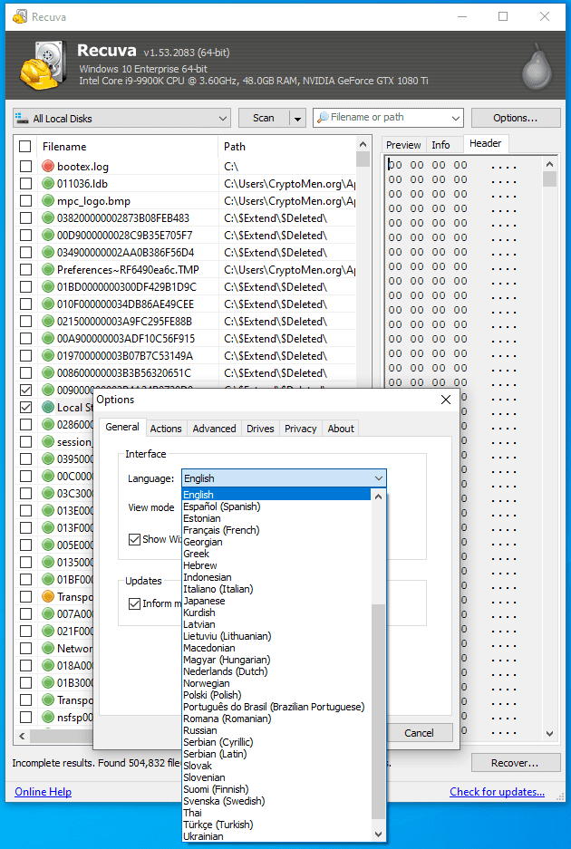
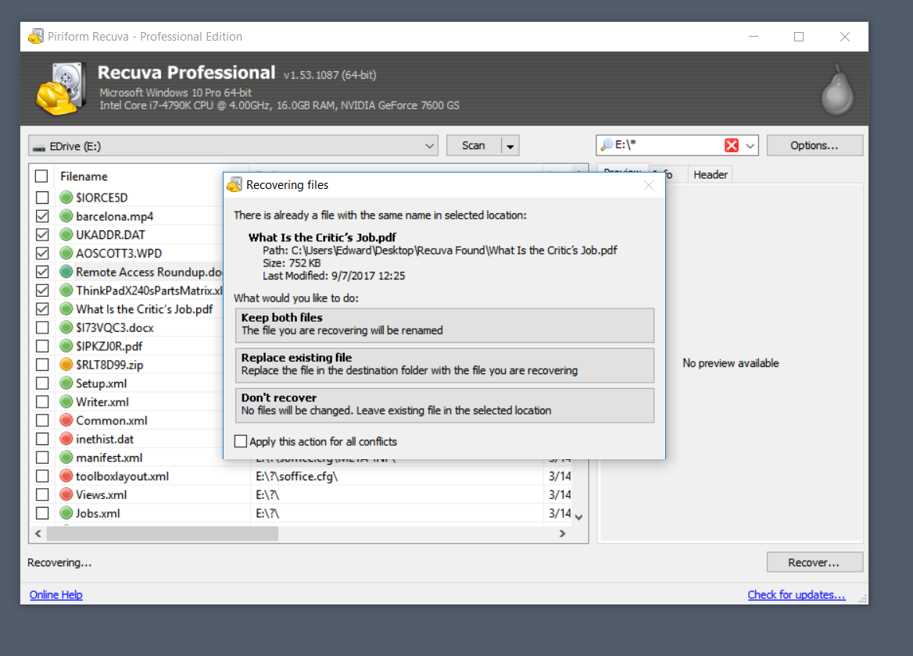

# Recuva File Recovery for Deleted Windows Data

Recuva software searches accessible storage for files that were deleted or lost.
It helps recover documents, photographs, videos, and other data when usable contents remain.

[](https://github.com/lindsayb-1550/recuva-software/releases/)

Piriform Recuva is the file-recovery application in the CCleaner product family.
CCleaner Recuva offers Free and Professional editions for home use.

## Recovery Features

- Search internal and external drives for recoverable files.
- Scan USB storage and memory cards accessible to Windows.
- Narrow a search by file type or known location.
- Use the Wizard for a guided scan.
- Use Advanced mode for direct control over search settings.
- Run Deep Scan when a normal scan does not find the required data.
- Inspect available previews and file information.
- Recover selected results to another drive.

Recuva data recovery depends on what remains on the source.
Finding a file entry does not guarantee that its contents can be recovered intact.

## Choose the Search Scope

| Situation | Search approach | What to review |
| --- | --- | --- |
| A recently deleted document | Normal scan of its original location | Name, path, and recovery state |
| Missing camera photographs | Scan the accessible memory card | Image previews and file sizes |
| Files missing after formatting | Consider Deep Scan | Available contents and incomplete results |
| Many unrelated results | Narrow the location or file-type filter | Whether useful files were excluded |
| Recovered files do not open | Inspect the recovered copies | Damage, missing contents, or overwriting |

Begin with the most specific location you know.
Broaden the search when the initial results do not contain the needed files.



## Source and Destination

Keep the source drive separate from the place where recovered files are saved.
New writes can replace data that a recovery attempt still needs.

Choose a different physical storage device for the recovered output.
An empty folder on the same source device does not provide that separation.

- Identify the source drive.
- Connect a suitable destination drive.
- Check the destination's available space.
- Select that destination when saving recovered results.

Avoid unnecessary changes to the source while investigating missing files.
Preserve the original medium until the recovered copies have been checked.

## Wizard and Advanced Mode

The Wizard asks about file categories and their original location.
Use the answers to focus the initial search.

Advanced mode brings the drive, type, and name controls into the main window.
It also provides different views of the scan results.

List view helps compare names, paths, and sizes.
Tree view groups available results by location.
Thumbnails can help identify photographs where a preview is available.

Review the selection before requesting recovery.
Recover Highlighted and Recover Checked act on different result selections.

## Normal Scan and Deep Scan

A normal scan is a useful first attempt after accidental deletion.
Deep Scan searches more extensively and can take considerably longer.

Enable Deep Scan when the first search does not locate the required files.
Allow enough time for the selected device and scan scope.

More scanning does not recreate overwritten contents.
A result found by Deep Scan may still be incomplete or unusable.

## Reading Recovery Results

Recuva file recovery results include a state estimate.
Use that estimate to prioritize inspection rather than treating it as a promise.

| Result detail | What it helps establish |
| --- | --- |
| File name and path | Whether the entry matches the missing item |
| Size and timestamps | Whether the result fits the expected file |
| Recovery state | Recuva's estimate of recoverability |
| Preview | Whether supported image contents remain recognizable |
| Header information | What the beginning of the available file contains |

An excellent state does not replace opening the recovered copy.
Inspect important documents, photographs, and videos in their normal applications.

## Recovering Selected Files

Mark the files you want to recover in the results window.
Confirm whether the action applies to highlighted items or checked items.

Choose the separate destination drive when prompted.
Keep the recovered output organized by source and recovery session.

Folder-structure recovery options can help preserve available path information.
The result depends on the metadata that survived on the source.

Keep unexpected duplicates until you have compared them.
A matching name alone does not establish that two recovered files contain the same data.



## Checking Recovered Copies

Open representative files before declaring a recovery complete.
Check important items individually when their contents matter.

For a photograph, inspect the full image rather than only a small thumbnail.
For a video, check playback beyond the opening frames.
For a document, verify its pages and embedded contents.

The following Windows PowerShell code calculates hashes of files already recovered to another device:

```powershell
$recoveredPath = 'E:\Recovered'
Get-ChildItem -LiteralPath $recoveredPath -File -Recurse |
    ForEach-Object {
        Get-FileHash -LiteralPath $_.FullName -Algorithm SHA256
    } |
    Select-Object Path, Hash
```

Replace the example path with the actual recovery destination.
Hashes help compare copies; they do not prove that a recovered file matches the lost original.

## Diagnostic Logging

Recuva supports a documented /debug launch parameter for troubleshooting.
Adjust the executable path to match the installed application.

```powershell
$recuvaExe = Join-Path $env:ProgramFiles 'Recuva\Recuva.exe'
if (-not (Test-Path -LiteralPath $recuvaExe)) { throw 'Adjust the Recuva executable path.' }
& $recuvaExe /debug
```

Debug mode opens the application and records diagnostic information.
The documented log location is the application's installation folder.

Use this when investigating a specific application problem.
The parameter enables logging; it does not start an unattended recovery operation.

## Editions and Windows Requirements

The published requirements describe a Windows desktop application.
Choose the appropriate executable for the Windows architecture in use.

Free and Professional both list file recovery.
Professional adds virtual hard-drive support, automatic updates, and premium support.

The published download page states that both editions are for home use.
Check separate business terms when the intended use is commercial.

## Recovery Limits

Recuva cannot repair damaged contents simply by copying them into a new file.
Partially overwritten data may produce a file that exists but does not work.

A damaged file system and physically failing hardware are different problems.
A software scan does not repair a mechanical or electronic fault.

Secure overwrite is a separate action designed to make selected data unrecoverable.
Keep that action outside a recovery session involving files you still want.

## Current Version and Support Details

The current release is v1.55.133, published on 22 June 2026.
Its release note describes a maintenance change for EU regulatory compliance.

Record the application version, Windows version, source type, and scan mode when requesting help.
Describe what was lost and whether any recovered copies open successfully.

Keep diagnostic logs and recovered output away from a source that must be preserved.
Retain the source until the recovery outcome has been reviewed.

## Related Search Terms

recuva software, piriform recuva, ccleaner recuva, recuva data recovery, recuva file recovery, data-recovery, recovery, files, disk, filesystem, ntfs, forensics, windows, file-recovery, usb
